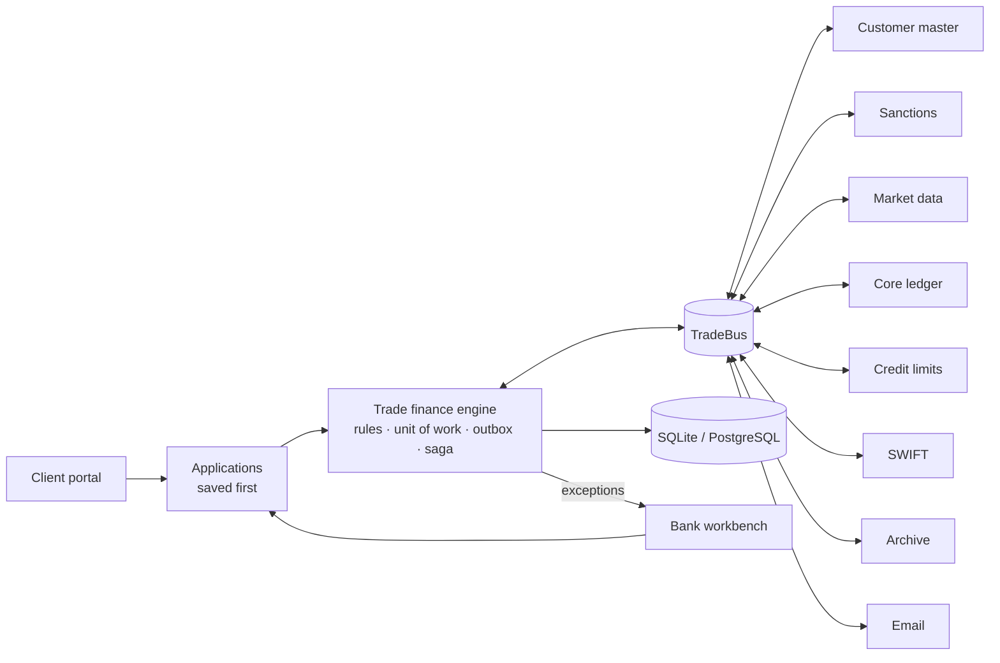

# Auto-Connect – Trade Finance Orchestration Platform

Auto-Connect connects the separate systems of a bank (customer master, sanctions screening, market data, core
ledger, credit limits, SWIFT, document archive, email, client portal) and runs trade finance transactions across
them automatically – from the client's application to payment and closing – while handing only real judgement calls
to people.

> **Demo project.** All bank names, BIC codes, customers and transactions in this repository are fictional
> ("Demo Bank AG", `DEMODEMM`). Bank systems are simulated unless you connect real ones. Not affiliated with any bank.

---

## Features

**Products** (each following its ICC / legal rule book)

| Product | Rules |
|---|---|
| Import letter of credit (issue, amend, documents, payment) | UCP 600, ISBP 821 |
| Export letter of credit (advise, confirm, transfer, present) | UCP 600 |
| Demand guarantee / counter-guarantee / standby | URDG 758, ISP98 |
| Surety bond (Bürgschaft) | §§ 765 ff. BGB |
| Documentary collection (D/P, D/A) | URC 522 |

**Automation**
- Customer & KYC check, EU/OFAC sanctions screening (incl. ports, vessels, dual-use goods), FX conversion (ECB),
  credit-limit reservation, double-entry booking, fees, SWIFT MT7xx and ISO 20022 (pacs.008/009) messages.
- Document reading: Gemini (optional) or the built-in reader (PDF text, Tesseract OCR, rules) → automatic
  examination against the credit terms → pay, or ask the client to accept discrepancies.
- People only decide exceptions: sanctions / KYC (Compliance), limit excess (Credit), unclear data (document checker),
  disputes (Legal) – with four-eyes and maker-checker rules.

**Reliability**
- Every action is one database transaction (all or nothing); external bookings are reversed automatically on failure
  (saga); emails and SWIFT messages leave only after commit (outbox); safe retries without double fees.
- SQLite or PostgreSQL; several servers can share one database.
- Original documents stored with a SHA-256 fingerprint; tamper-evident (hash-chained) audit log.

**Connecting real systems**
- Add an application by URL / OpenAPI, map its fields declaratively (no code), certify it with four-eyes approval.
- REST, file drop, SFTP and IBM MQ transports; OAuth 2.0, mTLS, proxy, host allow-list, secret references.

**Screens**
- **Client portal** (`/portal`) – apply, upload documents, correct or withdraw applications, request amendments,
  answer the bank's questions, follow every step in plain language.
- **Bank workbench** (`/bank`) – today's work, decisions with a plain explanation of each choice, applications,
  transactions as a story, customers and limits, Excel report.
- **Technical console** (`/trade`) and **integration dashboard** (`/`).

---

## Quick start

Requirements: Python 3.11+. Optional: Tesseract + Poppler for scanned documents, Docker for PostgreSQL.

```bash
git clone https://github.com/<your-account>/auto-connect.git
cd auto-connect
python3 -m venv .venv
.venv/bin/pip install -r requirements.txt
cp .env.example .env          # optional: add a Gemini key / SMTP settings
.venv/bin/python -m auto_connect.main --server --port 8088
```

Open:

| Address | What |
|---|---|
| http://127.0.0.1:8088/portal | Client portal (demo: pick a company) |
| http://127.0.0.1:8088/bank | Bank workbench (demo: pick an employee) |
| http://127.0.0.1:8088/trade | Technical console |
| http://127.0.0.1:8088/ | Integration dashboard |

Terminal demo of complete lifecycles (in-memory, nothing saved):

```bash
.venv/bin/python -m auto_connect.main --trade-demo
```

### Docker (PostgreSQL, production mode)

```bash
export TF_DB_PASSWORD=$(openssl rand -hex 16)
docker compose run --rm app python -m auto_connect.security add-user --id ops1 --name "Ops One" --roles OPERATIONS
docker compose up -d          # http://127.0.0.1:8088  (GET /ready)
```

Production mode requires named users (personal access keys, roles), disables demo features and API docs.
Client users: `python -m auto_connect.security add-user --id acme.cfo --name "CFO" --roles CLIENT --customer-id DE-CORP-40551`.

---

## Configuration

All settings are environment variables – see [`.env.example`](.env.example). The most important:

| Variable | Meaning |
|---|---|
| `AUTO_CONNECT_DATABASE_URL` | `sqlite:///state/bank.db` or `postgresql://user:pw@host/db` |
| `AUTO_CONNECT_ENV=production` | named users, role permissions, no demo endpoints |
| `GEMINI_API_KEY` | optional; without it the built-in rules and reader are used |
| `SMTP_*`, `SEND_LIVE_EMAIL` | email delivery (`false` = write `.eml` files only) |
| `TF_LIVE_REFERENCE_DATA` | download ECB rates and EU/OFAC lists (`false` = built-in samples) |
| `TF_SYSTEM_URL_<AGENT_ID>` … | connect a bank system to a real application |
| `BANK_NAME`, `BANK_BIC` | the operating bank's identity |

---

## How it works



Each bank system is a *role*. By default a built-in simulator plays it; binding a real application (by URL, with a
field mapping) replaces the simulator without code changes. Details: [docs/ARCHITECTURE.md](docs/ARCHITECTURE.md).

---

## Project structure

```
auto_connect/
  main.py, dashboard.py      entry point, web server, integration dashboard API
  security.py                users, roles, four-eyes, audit log
  executor.py, transports.py outbound calls: REST / file / SFTP / IBM MQ, OAuth2, mTLS
  vault.py                   credential vault (secret references)
  document_reader.py         document reading (Gemini or built-in OCR + rules)
  brain.py, introspector.py  application discovery and onboarding
  trade/
    engine.py, products.py   trade finance workflows (LC, guarantee, surety, collection, export LC)
    rules.py                 UCP 600 / URDG 758 / BGB / URC 522 checks
    swift.py, iso20022.py    SWIFT MT and ISO 20022 messages
    systems.py               the bank-system roles (simulators) and the TradeBus
    integration.py, mapping.py  connecting real applications, field mapping, certification
    database.py, state.py    persistence (SQLite / PostgreSQL / JSON), unit of work
    portal_api.py, plain.py  client portal + bank workbench APIs, plain-language views
    api.py                   REST API (/api/v1/tf/...)
  templates/                 web pages (no external CDN for the portals)
tests/                       pytest suites + landscape / client-audit integration runs
docs/                        architecture, deployment guide, operations runbook
```

---

## Tests

```bash
.venv/bin/pip install -r requirements-dev.txt
.venv/bin/pytest -q                                   # unit + integration tests (SQLite)
TEST_POSTGRES_URL=postgresql://postgres:pw@127.0.0.1:5432/postgres .venv/bin/pytest -q   # also on PostgreSQL
.venv/bin/python -m tests.landscape.run_landscape     # 7 vendor systems + SFTP + SMTP in Docker
.venv/bin/python -m tests.audit.run_client_audit      # client scenarios with uploaded documents and emails
```

---

## Status and limitations

Ready for a pilot in a bank's **test** environment, not for live use. Before go-live a bank must provide: access and
specifications of its real systems (then write the field mappings), SWIFT connectivity, licensed screening data if
required, its single sign-on and secret vault, security / compliance approval and a parallel run.
Known gaps: single sign-on (OIDC) for staff and clients, German-language texts, per-client pricing, metrics endpoint,
record-retention rules. See [docs/DEPLOYMENT_GUIDE.md](docs/DEPLOYMENT_GUIDE.md).

## Documentation

- [Architecture](docs/ARCHITECTURE.md)
- [Deployment guide](docs/DEPLOYMENT_GUIDE.md)
- [Operations runbook](docs/RUNBOOK.md)
